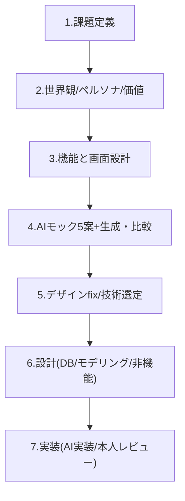
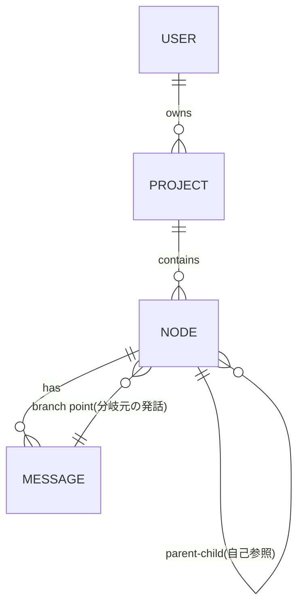

# 思考の樹形図（AIネスト可視化フルスタックWebアプリ）

> **このファイルが正本（source of truth）。** 実装TODOは [CHECKLIST.md](CHECKLIST.md) を参照。
> `.cursor/plans/nest_chat_visualizer_82c98f61.plan.md` は Cursor 時代の履歴。以後更新しない。

AI（Claude/GPT）と公式API経由で対話し、学習の枝分かれ（ネスト）を「思考の樹形図」として可視化するフルスタックWebアプリ。CRUD・自作API・認証・DBモデリングを実践・証明するポートフォリオを兼ねる。実装前に課題→言語化→画面設計→モック→技術選定→設計→実装の7フェーズをコーチング型壁打ちで進め、各判断を自分の言葉で説明できる状態を作る。

## 進め方（7フェーズ）

進行ルール: AIは答えを押し付けず、問いとトレードオフを提示して本人の判断を引き出す。各フェーズの結論をプランに追記して資産化する。

進捗: Phase1〜6 完了 / Phase7（実装）進行中 — Step1〜3、Step4（CRUD＋認可）、橋渡し（祖先パス再帰CTE＋ContextBuilder）、**Step5（AI連携）完了＝バックエンドの主機能が一通り動く状態**。次は Step6（フロント React SPA）。

---

## Phase1 課題定義（確定）

- 痛みのエピソード: Laravel の Eloquent(ORM) を調べていたら DB の低レイヤーへ次々と潜行し、最初の「Laravelの DB が知りたい」に戻れなくなった。深掘り（同分野を潜る）と脱線（領域をまたぐ）の両方で文脈を見失う。
- 現状の対処: 紙やメモ帳に「今どこを調べているか」を書く。ただし紙を用意する手間が負担。
- 対象: AIを学習ツールとして使う人全般。
- コアバリュー: 「来た道（学習の探索過程）」が残り、いつでも元の枝に戻れること。「手間ゼロ」の真意は"操作ゼロ"ではなく"紙を用意しなくてよい"。
- 構造の決定 → ツリー型: 深掘り(スタック的)と領域横断の脱線(分岐)が両方起きるため。
- 記録方式の決定 → 手動分岐: 「自分の手で構造化する行為自体が学習効果」。手動は手間ではなく価値。
- 30秒ピッチ: 「AI学習では深掘りと脱線で文脈が枝分かれし、元々何を学んでいたか見失う。紙のメモは負担。だから探索過程を木構造として残し、いつでも元の枝に戻れ、かつ"自分で構造化する行為"で理解も深まるツールを作った。」

## Phase2 世界観・ペルソナ・提供価値（確定）

- プロダクト名 / 世界観: 「思考の樹形図」。学習の探索を木として外部化し、現在地を俯瞰できる体験。
- ペルソナ: 独学でプログラミングを学ぶ学生・初心者。GPT/Claude を先生代わりに毎日大量に質問。
- ペルソナの痛み(2段階):
  - 痛みA: 来た道を見失う（現在地ロスト）。
  - 痛みB(本質): 知識の全体像=地図を持っていないため、潜りすぎ・脱線に気づけない。
- 提供価値(一行): プログラミング学習者が「今どこを学んでいるか」を把握でき、本来学ぶべきところを時間を無駄にせず効率的に学べるようにする。
- 記録方式の最終形=ハイブリッド: 土台は手動分岐(学習効果)、補助輪としてAIが話題転換を検知して枝を提案(痛みBを補う)。最終判断は本人。MVPは手動、次段でAI提案。

## Phase3 機能と画面設計（確定）

- アーキ方針: フルスタックWebアプリに転換（CRUD/自作API/認証/DBモデリングを実践・証明するため）。
- メイン画面=3ペイン構成（馴染みのチャットUI＋右に地図）:
  - 左: 学習テーマ(=Project)一覧 / 中央: チャット(主役) / 右: 思考の樹形図(同Project内のNode構造)
- 中核インタラクション:
  - 枝を作る: チャットのAI回答から「ここから枝を作る」→ 新ノード生成＋チャット切替。
  - 移動/戻る: 樹形図のノードクリック→ チャットがそのノードのスレッドに切替。
- 画面一覧: サインアップ / ログイン / メイン画面 / 設定。

## Phase4 モック（確定: 案6 マインドマップ型）

- React のクリックできるモックを `prototype/mock.html` に作成（ディスク満杯のため node_modules 不要の CDN 版で実装、全案動作確認済み）。
- 閲覧: `prototype/` で `python3 -m http.server 8123` → `http://localhost:8123/mock.html`。
- 採用: 案6 マインドマップ型。
  - チャット主役（中央・パンくず付き）。左テーマ／右マインドマップは各々開閉可、全画面化も可。
  - マインドマップは中心テーマから子へ曲線(ベジェ)で広がる横型。現在地までの経路をハイライト。
  - Phase7 で @xyflow/react に載せ替えて pan/zoom 対応にする。

## Phase5 技術選定・アーキテクチャ（確定）

- 構成A デカップリング:
  - フロント: React + TypeScript + Vite（SPA）／ マインドマップ @xyflow/react
  - バックエンド: Laravel（PHP）で自作 REST API
  - 認証: Laravel Sanctum（自分のツリーのみアクセス可の認可）
  - DB: MySQL
  - AI呼び出し: サーバ側から Anthropic/OpenAI（キーは `.env`）
- 構成根拠: 目的（自作API・認証の実践/証明）に直結。CORS・トークン認証・フロント/バック分離まで語れる。
- リポジトリ（実態）: `api/`（Laravel）＋ `prototype/`（モックの React/Vite）。`prototype/` を `frontend/` へ昇格するのは未実施。

## Phase6 データモデリング・スキーマ（確定）

- ツリー表現 → 隣接リスト（`parent_id`）＋ MySQL8 再帰CTE。
  - 根拠: 枝追加が頻繁・ツリーは小さい → 挿入が軽い隣接リストが最適。全ツリーは `WHERE project_id=?` 一括取得しアプリ側で組み立て。パスは再帰CTE。
  - なぜ1本の `parent_id` で親も子も表せるか: 親子は「向きのある1つの事実」。親は最大1つ（1列に収まる）だが子は可変個（持たせると列が無限に増える）。よって「1しかない側＝子が親を指す」形で保存し、子は逆引き（`WHERE parent_id = 自分のid`）で導出する。
  - 将来: 必要ならクロージャテーブルへ移行可能、と語れる。

- 確定スキーマ（MySQL / 実装済み）:
  - `users(id, name, email[unique], password, timestamps)`
  - `projects(id, user_id[FK→users, cascade], project_name, timestamps)`
  - `nodes(id, project_id[FK→projects, cascade], parent_id[FK→nodes nullable, cascade], branch_from_message_id[FK→messages nullable, nullOnDelete], summary, timestamps)`
  - `messages(id, node_id[FK→nodes, cascade], role[string ※DB の ENUM ではなくアプリ層で検証], content TEXT, timestamps)`
- 分岐点の表現 → `branch_from_message_id`（`messages` への FK）:
  - 根拠: 位置(index)ではなく**発話の同一性**で指すため、メッセージの編集・削除でズレない。
  - `parent_id` との役割分担: `parent_id` は「どのノードから」、`branch_from_message_id` は「そのノードのどの発話から」。同じ親から複数の枝が別地点で分岐するため、両方が必要。
  - onDelete = `nullOnDelete` の根拠: message 個別削除は起きない（削除は project 単位、または葉ノード単位のみ）。`restrict` はプロジェクト削除のカスケードを阻害する恐れ、`cascade` は学習履歴を枝ごと失いコアバリューと矛盾。よって非破壊の nullOnDelete。
  - 削除方針（Step4 で確定）: **削除経路は「project 単位削除」と「葉ノードの個別削除」の2つ**。中間ノードの単体削除（中抜き）は 409 で拒否し、学習履歴を一括で失わない。node の子はアプリ層で `children()->exists()` を検証（`parent_id` の FK cascade には頼らない）。
  - マイグレーションは既存3本を編集せず、`messages` より後に走る新規マイグレーションで後付け（順序制約＋「走った後は編集しない」台帳ルール）。
- 非機能要件（最低限）:
  - 認可: 全 project/node/message 操作で所有者検証（Policy/Gate）。
  - APIキー: `.env` でサーバ管理。フロントへ出さない。
  - N+1対策: eager load (`with`)。
  - 文脈組み立て: 対象ノードから `parent_id` の鎖を根まで辿り、各ノードで「**その子の `branch_from_message_id` まで**」の `messages` を採用して連結→サーバからAIへ送信。
    - 例（A→B→D）: A は Bの分岐点まで / B は Dの分岐点まで / D は自ノード全部 → 時系列で連結。脱線側・分岐後の発話は含めない。
    - 遡れる理由: messages は `node_id` で各ノードに永続保存され消えず、各ノードは「親のどこで分かれたか」だけ覚えているため、鎖を辿れば来た道の必要部分だけを復元できる。

## Phase7 実装（進め方を更新）

**AIの立ち位置が変わった。** 従来の「本人主導で実装、AIはヒント役」から、本人のエンジニア像の更新（＝コードを書くことより、**技術選定し、AIが書いたコードを読んで理解・評価する**）に合わせ、次のループで進める:

> **技術選定（選択肢＋トレードオフを本人が言語化）→ AIが実装 → 本人がコードを読んでレビュー・評価 → 「なぜ選んだか / どこで詰まったか / トレードオフ」を自分の言葉で記録**

- 単位は「**スライス**」= DB→API まで縦一気通貫の薄い機能のかたまり。一度に全部作らず、レビュー・記録できる粒度で積む。
- 狙い: 各スライスで評価軸 Lv1（技術選択の理由を説明できる）/ Lv2（失敗・判断・解決を語れる）/ Lv3（トレードオフ・拡張性を語れる）を担保する。AI任せで説明できない「バイブコーディング」を避けることが絶対条件。
- 記録先: `api/README.md` の設計判断ログ（＝そのまま面接台本にする）。

進捗: Step1〜3 ／ Step4 スライス1（projects CRUD＋`ProjectPolicy`）／ Step4 スライス2（nodes+messages CRUD＋`NodePolicy`, shallow nest, 葉のみ削除）／ 橋渡し（`Node::ancestorPath()` 再帰CTE＋`ContextBuilder`・path/context API）／ **Step5（AI連携: 公式PHP SDK＋`AnthropicClient` ラッパ・同期・`POST /nodes/{node}/chat`）** 完了。**全57件緑**（AI呼び出しはモックのため課金なし）。設計判断は `api/README.md`。次は Step6（フロント React SPA）。具体タスクは [CHECKLIST.md](CHECKLIST.md)。

---

## 注意点

- AI利用は従量課金（APIキーが必要）。キーはサーバー側で管理しフロントに出さない。
- マインドマップが深くなると重なりやすい → レイアウト計算/pan-zoom 前提。
- 自己参照ツリーの取得で N+1 が起きやすい → eager load。
- **PHP 8.4 必須**（Composer が `>= 8.4.1` を要求）。`php` は 8.2 に解決されて artisan が落ちるため、`/opt/homebrew/opt/php@8.4/bin/php` を使う。
- テストは SQLite `:memory:` で走る（`phpunit.xml`）。開発DB `nest`（MySQL）は汚れない。
