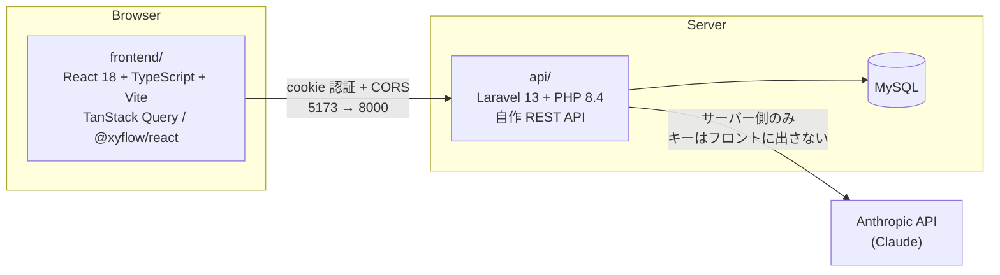
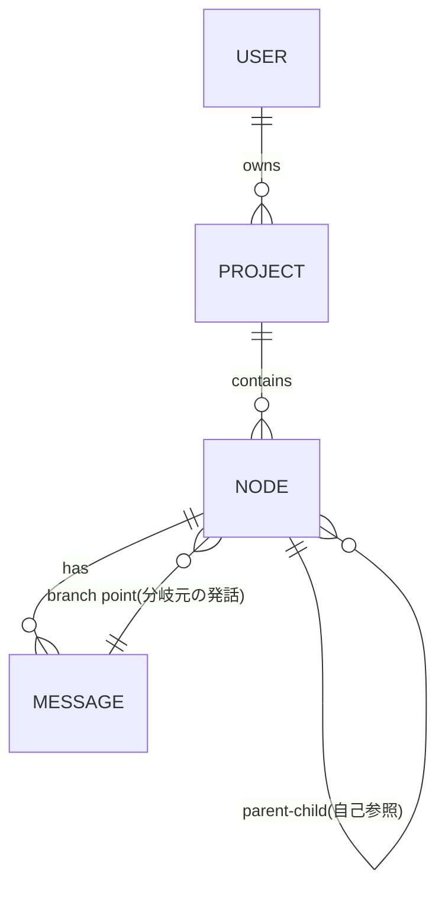

# 思考の樹形図

**AI との学習対話を「木」として残し、深掘りと脱線で見失った現在地に、いつでも戻れるようにする Web アプリ。**

> AI 学習では深掘りと脱線で文脈が枝分かれし、元々何を学んでいたか見失う。紙のメモは負担。だから探索過程を木構造として残し、いつでも元の枝に戻れ、かつ「自分で構造化する行為」で理解も深まるツールを作った。

React + TypeScript の SPA と Laravel の自作 REST API を分離構成で組み、Sanctum の cookie 認証・自作の再帰CTE・Anthropic API 連携までを実装したフルスタック個人開発です。

---

## 解いている課題

Laravel の Eloquent を調べていたら DB の低レイヤーへ次々と潜行し、最初の「Laravel の DB が知りたい」に戻れなくなった、という実体験が出発点です。

| | 痛み |
|---|---|
| **A** | **来た道を見失う。** 深掘り（同じ分野を潜る）と脱線（領域をまたぐ）の両方で文脈が枝分かれし、現在地が分からなくなる |
| **B（本質）** | **知識の全体像＝地図を持っていない。** だから「潜りすぎ」「脱線」に自分で気づけない |

痛みAには**木構造として履歴を残すこと**、痛みBには**その木を俯瞰できる地図にすること**で答えています。

### 中核となる体験

1. チャットで AI に質問する（左：学習テーマ／中央：チャット／右：マインドマップ）
2. 話が逸れたと感じたら、その AI 回答から「**ここから枝を作る**」——新しいノードが生えて会話がそこへ移る
3. マインドマップやパンくずから**元の枝に戻る**。会話はノードごとに保存されているので続きから再開できる

**枝は自動では作られません。** 自分の手で構造化する行為そのものに学習効果がある、という判断からの手動分岐です（AI による枝の提案は発展課題として設計だけ残し、実装は見送りました）。

---

## アーキテクチャ



フロントとバックエンドを**別オリジンのまま**繋いでいます。開発中も本番と同じクロスオリジン cookie 認証の経路を常に通すためで、Vite の dev proxy はあえて使っていません。

### 技術選定

| 領域 | 選択 | 選んだ理由（要約） |
|---|---|---|
| フロント | React 18 + TypeScript + Vite | SPA として画面遷移とキャッシュを自前で持つ構成にするため |
| サーバー状態 | TanStack Query | **サーバーの真実**（キャッシュ）と**UIの関心事**（今どこを見ているか）を分離できる |
| マインドマップ | @xyflow/react | pan/zoom・初期フィット・座標変換が実績のある実装で手に入る。**レイアウト計算は自前のまま**残した |
| バックエンド | Laravel 13 / PHP 8.4 | 自作 REST API・認可・DB モデリングを一通り実践するため |
| 認証 | Sanctum SPA cookie セッション | HttpOnly Cookie で XSS 耐性。CORS・CSRF・SameSite まで含めて理解する狙い |
| DB | MySQL 8 | 再帰CTE が使える。ツリーは隣接リストで保持 |
| AI | Anthropic 公式 PHP SDK | `AnthropicClient` でラップし、乗り換えコストを1ファイルに閉じ込めた |

---

## データモデル



- **ツリーは隣接リスト（`parent_id`）＋ 再帰CTE**。枝の追加が頻繁でツリー自体は小さいため、挿入が軽い隣接リストを選択。祖先パスの取得だけ `WITH RECURSIVE` で1クエリにしています
- **分岐点は `branch_from_message_id`（messages への FK）**。位置（index）ではなく**発話の同一性**で指すので、メッセージの編集・削除でズレません
- **AI に送る文脈の復元**: 対象ノードから根まで辿り、各ノードで「**その子が分岐した発話まで**」の messages を連結します。これにより脱線側・分岐後の発話は混ざりません

---

## セットアップ

### 必要なもの

- **PHP 8.4**（⚠️ `php` が 8.2 に解決される環境では Composer が拒否します。`/opt/homebrew/opt/php@8.4/bin/php` のようにフルパスで実行してください）
- MySQL 8 / Node.js 20+
- Anthropic の API キー（チャット機能を使う場合のみ。**従量課金**）

### 起動

```bash
# 1) バックエンド
cd api
cp .env.example .env
# .env の DB 接続と ANTHROPIC_API_KEY を設定
composer install
/opt/homebrew/opt/php@8.4/bin/php artisan key:generate
/opt/homebrew/opt/php@8.4/bin/php artisan migrate
/opt/homebrew/opt/php@8.4/bin/php artisan db:seed   # デモデータ（追加的・既存データは消えません）
/opt/homebrew/opt/php@8.4/bin/php artisan serve     # → http://localhost:8000
```

```bash
# 2) フロントエンド（別ターミナル）
cd frontend
npm install
npm run dev                                          # → http://localhost:5173
```

デモアカウント: `demo@example.com` / `password`

> チャット送信は Anthropic API を実際に呼ぶため課金されます。枝作成・テーマ作成・ツリー操作はキーなしで動きます。

### テスト

```bash
cd api && /opt/homebrew/opt/php@8.4/bin/php artisan test
```

**68件**（Pest）。AI 呼び出しは自作ラッパをモックするので、テストは常に課金ゼロです。

---

## ドキュメント

| | 内容 |
|---|---|
| **[api/README.md](api/README.md)** | **設計判断ログ。** 各スライスで「なぜそれを選んだか / どこで詰まったか / トレードオフ」を記録しています。**最初に読むならここ** |
| [PLAN.md](PLAN.md) | 全体設計の正本。課題定義からデータモデリングまで Phase1〜7 |
| [CHECKLIST.md](CHECKLIST.md) | 実装タスクと日付順のセーブポイント |
| `prototype/` | 画面設計の比較モック（案1〜6）。採用したのが案6のマインドマップ型 |

### 進め方

このプロジェクトは次のループで進めました。

> **技術選定（選択肢とトレードオフを本人が言語化して決定）→ AI が実装 → 本人がコードを読んでレビュー → 判断を記録**

単位は「スライス」＝レビューできる粒度の薄い縦切りです。git の履歴も設計判断ログもスライス単位で対応しています。実装できたことより、**なぜその実装を選んだかを説明できること**を目的にしています。
